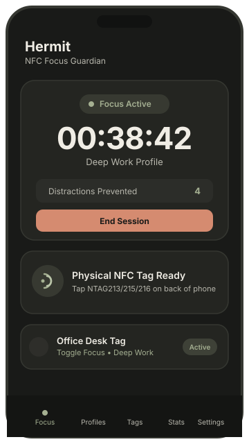
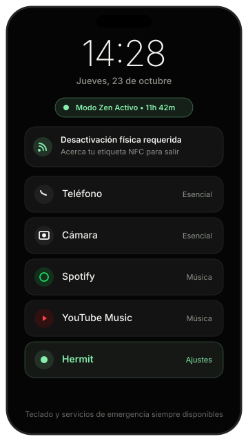
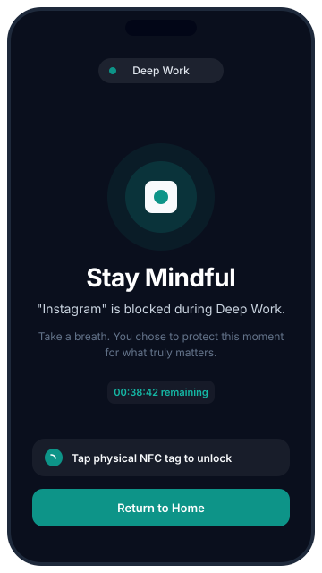

<p align="center">
  <a href="https://hermit.umarmohammad.xyz">
    
  </a>
</p>

<h1 align="center">Hermit</h1>

<p align="center">
  <b>Un santuario físico y sereno frente a las distracciones digitales mediante etiquetas NFC estándar.</b><br>
  <i>100 % local • Bloqueo genuino de apps en Android • Libre y de código abierto</i>
</p>

<p align="center">
  <a href="https://github.com/mr-umar/Hermit/releases/latest">
    
  </a>
  &nbsp;&nbsp;
  <a href="https://hermit.umarmohammad.xyz">
    
  </a>
  &nbsp;&nbsp;
  <a href="https://github.com/mr-umar/Hermit/releases">
    
  </a>
</p>

<p align="center">
  <a href="https://github.com/mr-umar/Hermit/releases"></a>
  
  <a href="LICENSE"></a>
  
  
</p>

<p align="center">
  <a href="README.md"><b>English</b></a> • <a href="README.es.md"><b>Español</b></a>
</p>

<p align="center">
  
  &nbsp;&nbsp;
  
  &nbsp;&nbsp;
  
</p>

Hermit convierte etiquetas NFC estándar y económicas en un ancla física frente a las distracciones digitales. Al vincular el gesto tangible de acercar el teléfono con el bloqueo genuino de aplicaciones a través del `AccessibilityService` de Android y un **Launcher Zen** integrado, Hermit te ayuda a cultivar un estado de concentración profundo y sereno, sin hardware propietario, sin suscripciones y sin vigilancia en la nube.

---

## Tabla de Contenidos

1. [Filosofía y Enfoque](#filosofía-y-enfoque)
2. [Onboarding Adaptativo y Perfiles](#onboarding-adaptativo-y-perfiles)
3. [Launcher Zen Integrado (Modo Zen)](#launcher-zen-integrado-modo-zen)
4. [Funcionalidades Principales](#funcionalidades-principales)
5. [Arquitectura y Tecnologías](#arquitectura-y-tecnologías)
6. [Compatibilidad de Etiquetas NFC](#compatibilidad-de-etiquetas-nfc)
7. [Especificación del Payload NDEF](#especificación-del-payload-ndef)
8. [Implementación del Bloqueo de Aplicaciones](#implementación-del-bloqueo-de-aplicaciones)
9. [Seguridad y Protección contra Desinstalación](#seguridad-y-protección-contra-desinstalación)
10. [Limitaciones de Fabricantes de Android](#limitaciones-de-fabricantes-de-android)
11. [Permisos y Privacidad](#permisos-y-privacidad)
12. [Guía de Compilación e Instalación](#guía-de-compilación-e-instalación)
13. [Pruebas Automatizadas](#pruebas-automatizadas)
14. [Sitio Web y Despliegue](#sitio-web-y-despliegue)
15. [Licencia](#licencia)

---

## Filosofía y Enfoque

Los teléfonos inteligentes modernos están optimizados para captar la atención de forma constante. La fuerza de voluntad frente a la pantalla suele ser insuficiente para frenar la memoria muscular automática.

Hermit introduce una **fricción física intencionada**:
1. **Sin perfiles basura por defecto:** Hermit parte de un lienzo limpio. Tú defines tus perfiles según tus necesidades reales de concentración.
2. **Configuración adaptativa:** Si aún no tienes una etiqueta NFC, puedes crear perfiles protegidos por temporizador (hasta 12 horas) con salidas de emergencia configurables. Si vinculas una etiqueta NFC, desbloqueas el interruptor físico universal y el **Launcher Zen**.
3. **Anclaje físico:** Acercar el teléfono a tu etiqueta activa o desactiva la sesión de forma inmediata.
4. **Pausa consciente y reclusión Zen:** Abrir una app bloqueada muestra una pantalla de respiración consciente. En Modo Zen, tu pantalla de inicio se transforma en un entorno OLED minimalista que solo muestra lo imprescindible.
5. **Privacidad absoluta:** El 100 % de tus datos, estadísticas y hábitos se procesan y almacenan en local en tu dispositivo.

---

## Onboarding Adaptativo y Perfiles

Hermit guía al usuario con un asistente inicial de dos pasos inteligente y adaptado a su equipamiento:

- **Paso 1: Vincular Etiqueta NFC (Omitible):**
  - Acerca cualquier etiqueta estándar NTAG213, NTAG215 o NTAG216 para enlazarla de inmediato.
  - Si no dispones de etiqueta en ese momento, pulsa **"Omitir por ahora"** para continuar sin bloqueos.
- **Paso 2: Creación Adaptativa del Primer Perfil:**
  - **Sin Etiqueta NFC (Modo Temporizador):**
    - Crea perfiles de bloqueo con una cuenta atrás de hasta un **máximo estricto de 12 horas**.
    - Opción de salida de emergencia: habilitada por defecto tras una pausa reflexiva de 60 segundos, pero completamente desactivable por el usuario para un bloqueo irrevocable hasta el fin del tiempo.
    - El Modo Launcher Zen permanece desactivado (requiere etiqueta física NFC para salir con seguridad).
  - **Con Etiqueta NFC (Interruptor Físico y Modo Zen):**
    - La etiqueta funciona como un **Interruptor Físico Universal**: un toque activa o desactiva la sesión del perfil que tengas seleccionado en la app.
    - Desbloquea la opción de **Modo Zen (Launcher)** con salida exclusiva mediante etiqueta física NFC.
    - Todas las sesiones están amparadas por un tope interno de seguridad de 12 horas.

---

## Launcher Zen Integrado (Modo Zen)

Hermit integra un entorno de inicio minimalista (`ZenLauncherActivity`) diseñado para silenciar por completo el ruido visual:

- **Interfaz OLED Negra:** Lienzo negro puro (`#000000`) con reloj digital, fecha, indicador de tiempo restante de sesión y aviso para desactivar mediante NFC.
- **Herramientas Esenciales Visibles:**
  - Teléfono (Marcador)
  - Cámara
  - Spotify (si está instalada)
  - YouTube Music (si está instalada)
  - Opcionalmente hasta 5 aplicaciones personalizadas elegidas por el usuario.
  - Hermit (para acceder a ajustes, estadísticas y perfiles).
- **Redirección del Botón de Inicio (Home):**
  - Mientras el Modo Zen está activo, cualquier intento de pulsar el botón Home o cambiar de app en el launcher del sistema devuelve al usuario al Launcher Zen a través del servicio de accesibilidad.
- **Protección Garantizada del Sistema:**
  - Teclados / métodos de entrada (IMEs como Gboard), llamadas de emergencia, ajustes del sistema y Hermit están en lista blanca obligatoria y **jamás se bloquean**.
- **Desactivación Física Estricta con NFC:**
  - Para salir del Launcher Zen antes de tiempo es imprescindible escanear la etiqueta NFC física vinculada (o esperar al tope de seguridad de 12 horas).

---

## Funcionalidades Principales

- **Interruptor Universal de Etiquetas NFC:**
  - Toca tu etiqueta para alternar (activar/desactivar) el perfil seleccionado en la pestaña Enfoque.
  - Asistente de grabación interactivo con verificación de lectura y alerta de sobrescritura.
  - Inspector de etiquetas que decodifica UID, chip, estado de solo lectura y memoria NDEF.
- **Bloqueo Real de Aplicaciones:**
  - `HermitAccessibilityService` supervisa aplicaciones en primer plano sin inspeccionar mensajes ni pulsaciones.
  - Ventana de amortiguación (debounce) de 1200 ms y persistencia tras reinicio (`BootReceiver`).
- **Perfiles a Medida:**
  - Selector de aplicaciones con filtro por categorías y búsqueda instantánea.
  - Temporizador configurable de hasta 12 horas con pausas reflexivas de 60 segundos opcionales.
- **Protección contra Desinstalación (Anti-Tamper):**
  - Privilegios opcionales de Administrador de Dispositivos para deshabilitar el botón de desinstalación de Android.
  - Desactivación protegida mediante una cuenta atrás consciente obligatoria.
- **Actualizaciones Integradas mediante GitHub Releases:**
  - Comprobador y descargador de actualizaciones directamente desde GitHub Releases con validación criptográfica SHA-256 e instalador APK interno.
- **Métricas e Historial Local:**
  - Registro de horas de enfoque, sesiones completadas y distracciones evitadas en base de datos Room cifrada.
- **Interfaz Bilingüe:**
  - Soporte completo en español (`values-es/`) e inglés (`values/`) con detección automática y cambio manual.

---

## Arquitectura y Tecnologías

Hermit se ha desarrollado de forma nativa en Android siguiendo las directrices de diseño de Apple HIG y Material 3:

- **Lenguaje:** Kotlin 2.0+
- **Interfaz de Usuario:** Jetpack Compose con componentes Material 3.
- **Principios de Diseño:**
  - Respuesta física táctil inmediata con muelles críticamente amortiguados (`damping: 1.0`, `scale(0.96)`).
  - Superficies translúcidas con desenfoque de fondo en barras de navegación.
  - Jerarquía tipográfica con espaciado negativo en títulos de gran tamaño.
- **Persistencia de Datos:**
  - **Room Database:** Almacenamiento estructurado de perfiles, etiquetas y sesiones.
  - **Preferences DataStore:** Estado atómico de la sesión activa, tema e idioma.
- **Concurrencia:** Corrutinas de Kotlin y flujos reactivos (`Flow`, `StateFlow`).
- **NFC:** Android `NfcAdapter`, `Ndef`, `NdefFormatable` y `enableReaderMode`.
- **Supervisión de Sistema:** Android `AccessibilityService` (`TYPE_WINDOW_STATE_CHANGED`).

---

## Compatibilidad de Etiquetas NFC

Hermit prioriza etiquetas estándar no propietarias compatibles con NFC Forum Tipo 2 e ISO 14443-3A:

| Familia de Chip | Memoria Útil | Estado de Compatibilidad | Notas |
| :--- | :--- | :--- | :--- |
| **NTAG213** | 144 bytes | **100% Compatible** | El payload compacto (&lt;120B) cabe holgadamente. Muy económico. |
| **NTAG215** | 504 bytes | **100% Compatible** | El estándar más común y accesible en el mercado. |
| **NTAG216** | 888 bytes | **100% Compatible** | Máxima capacidad para etiquetas Tipo 2. |
| **Tipo 2 Genérico / Formateable** | Variable | **Compatible** | Formateo NDEF automático si el hardware de la etiqueta lo admite. |
| **ISO 14443-4 / Tipo 4** | Variable | **Condicional** | Compatible si el controlador NFC del teléfono lo soporta como NDEF estándar. |

---

## Especificación del Payload NDEF

Las etiquetas grabadas por Hermit contienen un registro MIME específico de la aplicación seguido de un Android Application Record (AAR):

### Registro 1: Registro MIME Personalizado
- **Tipo MIME:** `application/vnd.xyz.umarmohammad.hermit`
- **Formato:** JSON codificado en UTF-8 con control de versiones:
  ```json
  {
    "v": 1,
    "id": "e4b3c2a1-6789-4def-0123-456789abcdef",
    "act": "TOGGLE",
    "pid": "default_deep_work",
    "name": "Etiqueta Escritorio"
  }
  ```
  - `v`: Versión del formato de payload (actualmente `1`).
  - `id`: UUID generado criptográficamente que identifica el registro de la etiqueta.
  - `act`: Acción de enfoque (`TOGGLE`, `ACTIVATE`, `DEACTIVATE`, `SWITCH`).
  - `pid`: Identificador del perfil asociado (opcional).
  - `name`: Nombre descriptivo de la etiqueta (opcional).

### Registro 2: Android Application Record (AAR)
- **Valor AAR:** `xyz.umarmohammad.hermit`
- Le indica al sistema operativo Android que abra o instale Hermit automáticamente al escanear la etiqueta.

---

## Implementación del Bloqueo de Aplicaciones

El bloqueo se ejecuta a través de `HermitAccessibilityService`:

1. **Filtrado de Eventos:** Escucha únicamente eventos `TYPE_WINDOW_STATE_CHANGED`. La lectura de contenidos de pantalla está deshabilitada (`canRetrieveWindowContent="false"`).
2. **Inspección de Primer Plano:** Obtiene el nombre del paquete de la aplicación que pasa a primer plano y lo compara con la lista de bloqueo del perfil activo.
3. **Lista Blanca de Seguridad:** El lanzador del sistema, la aplicación de teléfono, servicios de emergencia y los ajustes están completamente exentos.
4. **Protección de Bucle:** Un intervalo de 1200 ms evita disparos repetidos al alternar entre pantallas.
5. **Pantalla de Pausa:** Abre `BlockOverlayActivity` mostrando el mensaje consciente, el tiempo restante y la instrucción de desbloquear con la etiqueta NFC.
6. **Redirección de Inicio al Launcher Zen:** Al estar en Modo Zen, cualquier navegación al launcher del sistema devuelve al usuario al `ZenLauncherActivity`. Los teclados (IMEs), el marcador, la cámara y el propio Hermit permanecen 100 % exentos.

---

## Seguridad y Protección contra Desinstalación

Para evitar el autosabotaje impulsivo en momentos de distracción:

- **Protección como Administrador del Dispositivo:** Permite conceder privilegios de Administrador (`HermitDeviceAdminReceiver`). Android inhabilita el botón de "Desinstalar" en los ajustes del sistema mientras esté activo.
- **Pausa Reflexiva Obligatoria:** Desactivar la protección de Administrador requiere superar una cuenta atrás de reflexión consciente antes de permitir el acceso a los ajustes de desactivación.
- **Tope de Seguridad de 12 Horas:** Todas las sesiones incorporan un límite estricto de 12 horas (`SAFETY_12H_TIMEOUT`), garantizando que ante cualquier pérdida de la etiqueta o imprevisto, el dispositivo nunca quede bloqueado indefinidamente.

---

## Limitaciones de Fabricantes de Android

- **Optimización de Batería:** Fabricantes con políticas agresivas de gestión energética (Xiaomi MIUI/HyperOS, Huawei, Samsung OneUI) pueden suspender servicios de accesibilidad en segundo plano. Hermit incluye un acceso directo en **Ajustes &gt; Optimización de Batería** para solicitar la ejecución sin restricciones.
- **Ubicación de la Antena NFC:** La antena varía según el dispositivo (parte central en Google Pixel, esquina superior junto a la cámara en Samsung). Mantén la etiqueta firme durante la grabación.
- **Ajustes Restringidos en Android 13+:** En aplicaciones instaladas manualmente fuera de tiendas oficiales, Android exige autorizar "Ajustes restringidos" en la información de la app antes de habilitar el Servicio de Accesibilidad.

---

## Permisos y Privacidad

| Permiso | Propósito | Impacto en Privacidad |
| :--- | :--- | :--- |
| `android.permission.NFC` | Lectura y grabación de etiquetas físicas | Exclusivamente hardware local |
| `android.permission.BIND_ACCESSIBILITY_SERVICE` | Detectar apps bloqueadas y redirigir al Launcher Zen | Sin lectura de textos ni pulsaciones; solo nombres de paquetes |
| `android.permission.RECEIVE_BOOT_COMPLETED` | Restaurar sesiones de enfoque tras reiniciar | Estado de sesión local |
| `android.permission.VIBRATE` | Respuesta háptica al escanear | Sensorial |
| `android.permission.QUERY_ALL_PACKAGES` | Listar aplicaciones en el selector de bloqueo | Almacenado localmente en Room |
| `android.permission.INTERNET` | Consultar la API de GitHub Releases y descargar actualizaciones de APK | Exclusivo para releases verificadas con SHA-256; cero telemetría |
| `android.permission.REQUEST_INSTALL_PACKAGES` | Instalar actualizaciones de APK verificadas dentro de la app | Autorizado explícitamente por el usuario |

**Cero Vigilancia:** El acceso a internet se limita con exclusividad a comprobar y descargar versiones firmadas desde GitHub Releases con comprobación de hash SHA-256. Hermit no contiene analítica, rastreadores ni cuentas externas. El 100 % de tus datos permanece en tu dispositivo.

---

## Guía de Compilación e Instalación

### Requisitos
- JDK 17 o superior (verificado con OpenJDK 25).
- Android SDK con `compileSdk 35` y `build-tools 34.0.0+`.

### Compilar APK de Depuración
```bash
git clone https://github.com/mr-umar/Hermit.git
cd Hermit

# Configurar ruta del SDK en local.properties
echo "sdk.dir=C\:/Users/Umar/AppData/Local/Android/Sdk" > local.properties

# Compilar APK de depuración
./gradlew assembleDebug
```
El archivo APK se genera en:
`app/build/outputs/apk/debug/app-debug.apk`

### Instalar vía ADB
```bash
adb install -r app/build/outputs/apk/debug/app-debug.apk
```

---

## Pruebas Automatizadas

Ejecutar la suite completa de pruebas unitarias:
```bash
./gradlew testDebugUnitTest
```

---

## Sitio Web y Despliegue

El repositorio incluye un sitio web estático en el directorio [`website/`](website/):

- **Dominio de Producción:** [https://hermit.umarmohammad.xyz](https://hermit.umarmohammad.xyz)
- **Documentación de Despliegue:**
  - [Información del Sitio](website/README.md)
  - [Configuración DNS (CNAME)](website/DNS.md)
  - [Guía de Despliegue en GitHub Pages](website/DEPLOY.md)

---

## Licencia

Este proyecto está licenciado bajo la licencia **GNU Affero General Public License v3.0 (AGPL-3.0-or-later)**. Consulta el archivo [LICENSE](LICENSE) para más detalles.
